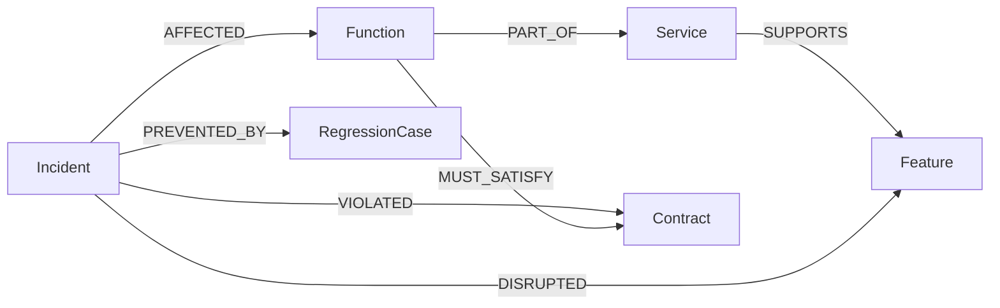

# RecurTrace

**Turn past outages into tests for your next release.**

RecurTrace connects a Python change to documented incident contracts in **FalkorDB**, builds regression tests from confirmed expectations, and executes those checks in the browser using **Pyodide**. The app includes a visual walkthrough and three reproducible examples.

## Hackathon entry

**Track: Agents That Act on Connected Data.** Repository: [vasudevan95/RecurTrace](https://github.com/vasudevan95/RecurTrace).

The optional review agent calls `retrieve_incident_memory` to obtain connected evidence from FalkorDB before explaining a change. The deterministic workflow selects confirmed regression cases and generates executable checks; the user starts their browser execution. The model does not autonomously fix code or claim test results.

**Demo video: pending recording and upload.** The [illustrated walkthrough](docs/VISUAL-DEMO.html) and [recording script](docs/DEMO-SCRIPT.md) are supporting materials, not a working-project video. See the [submission checklist](docs/SUBMISSION.md) for remaining requirements. Public hosting is not configured; complete local setup is provided below.

## AI coding-assistance disclosure

OpenAI Codex was used extensively to design and implement the backend, frontend, graph integration, tests, documentation, and setup tooling, and to execute verification checks. The participant selected the project direction, requested the implementation and revisions, specified the free-hosting constraint, and selected the publication account. This is an AI-assisted project, not a claim of independently handwritten code.

The verification record describes checks performed with coding-agent assistance; it does not establish the participant's personal technical understanding. Before submitting, the participant must personally review and run the project and be able to explain the graph model, queries, architecture, and limitations. That review has not been verified here. See the [technical walkthrough](docs/TECHNICAL-WALKTHROUGH.md).

This development assistance is separate from the app's optional runtime AI features. The default workflow needs no model or API key; live AI features require explicit configuration.

## Start on Windows

Prerequisites: Python 3.10+, Git, and Docker Desktop with its Linux engine running.

```powershell
git clone https://github.com/vasudevan95/RecurTrace.git
cd RecurTrace
```

Double-click **Start RecurTrace.cmd**, or run:

```powershell
.\Start-RecurTrace.ps1
```

Open http://127.0.0.1:8765. Select **Try the working demo**, **Trace this change**, then **Compare with corrected example**.

The first Python test run downloads Pyodide from jsDelivr. Internet access is needed for this initial runtime download. No AI API key is required.

Manual startup:

```powershell
python -m venv .venv
.\.venv\Scripts\python.exe -m pip install -r requirements.txt
docker compose up -d
.\.venv\Scripts\python.exe -m uvicorn app.main:app --host 127.0.0.1 --port 8765
```

## What is implemented

- Dashboard with real incident and locally recorded analysis counts.
- Structured incident entry; JSON import/export; optional AI-assisted report extraction with mandatory review.
- Optional live review agent that calls a workspace-scoped FalkorDB retrieval tool before explaining a change.
- Real FalkorDB storage and multi-hop retrieval: function → contract ← incident → regression case.
- Python AST comparison, including removed functions and module-level changes.
- Evidence paths, incident sources, analysis trace, and downloadable unittest code.
- Actual original/proposed/corrected Python comparisons in separate opaque-origin browser frames.
- Interactive knowledge graph and a six-step illustrated explanation.
- Browser-local history and report exports.
- Signed browser workspaces for public deployments; scoped graph queries; rate limits and input limits.
- A free Render Blueprint, local graph persistence, and Windows start/stop scripts.

## Demo scenarios

| Scenario | Existing coverage misses | Incident-derived check catches |
|---|---|---|
| Disappearing payment ID | Existing checks only assert status and amount keys | A subscription client's required `payment_id` key is missing |
| Duplicate charge | Existing checks cover one event and distinct events | Duplicate webhook IDs are processed more than once |
| Missing cent | Existing checks cover whole amounts | Decimal half-up rounding was replaced by float truncation |

All incidents, outages, and business examples are **synthetic demonstration data**. Test results are actually computed. Corrected versions are supplied examples, not claimed autonomous fixes.

## Architecture

```text
Browser interface ── JSON API ── FastAPI ── FalkorDB
       │                           │
       │                           └── optional AI extraction provider
       ├── localStorage: analysis history and test output
       └── opaque-origin sandbox iframe ── disposable worker ── Pyodide
```

The server parses uploaded Python but does not execute it. Browser execution is restricted to a separate iframe/worker with no app-origin access and CSP-limited network destinations. Each execution has a 12-second limit; runtime loading has a separate deadline. This is a demonstration runner, not a general-purpose security sandbox or trusted CI attestation. Hostile memory-heavy code can still exhaust browser resources. Only run code you are authorized to inspect.

No graph fallback is used: when FalkorDB is unavailable, retrieval fails clearly. Incident creation and its graph projections use one query. SQLite was intentionally removed from the hosted architecture because free Render services do not preserve local disks.

## Graph data model and essential queries

FalkorDB stores six node types: `Incident` (source facts and confirmed case payloads), `Function` (Python function name), `Service`, `Feature`, `Contract` (expected behavior), and `RegressionCase` (assertion and input data). Every node carries a workspace `tenant`; identifiers for shared entities include that tenant.



The essential retrieval query in [`GraphStore.relevant`](app/graph.py) is:

```cypher
MATCH (f:Function)-[:PART_OF]->(s:Service)
WHERE f.tenant=$tenant AND s.name=$service AND f.name IN $functions
MATCH (f)-[:MUST_SATISFY]->(c:Contract)<-[:VIOLATED]-(i:Incident)
WHERE i.tenant=$tenant
RETURN DISTINCT i.payload
```

Parameters come from the workspace and AST-detected function changes, not concatenated input. The returned incident JSON contains its confirmed regression cases. The runtime query traverses function/service/contract/incident relationships; it does **not** separately traverse `PREVENTED_BY` to load cases. Those case nodes are also stored for the graph view. This distinction matters when explaining the implementation.

Removing FalkorDB removes incident storage and relationship retrieval, so historical checks cannot be selected. There is no alternate database or hardcoded retrieval fallback. The diagram is a view of the same stored graph, not the product's only graph use. [`docs/GRAPH-QUERIES.md`](docs/GRAPH-QUERIES.md) includes the actual write, retrieval, visualization, and deletion queries with their parameters.

## Supported scope

Top-level synchronous Python functions, JSON-serializable test data, and standard-library examples. Cases support `equals`, `contains_key`, `length`, and `raises` (exception class name). Arbitrary repositories, classes/methods, asynchronous functions, external packages, distributed systems, GitHub PR integration, and automatic production fixes are outside this version.

No matching incident is a **coverage gap**, never a claim that a change is safe. The graph is only as good as the confirmed facts entered. Test expectations are not fabricated by a model.

## AI mode

The default portable workflow is explicitly **deterministic**: AST change detection, graph queries, and test templates. Optional live AI extracts a structured draft from a text report and reviews changes through a bounded tool-calling loop. It must retrieve incident evidence before answering. It never saves a draft without user confirmation, runs code, or modifies expected behavior silently.

On this computer, the existing Ollama `qwen2.5:7b` model has been connected through the ignored local `.env`. Both extraction and an evidence-backed tool-calling review were tested successfully. No cloud model call or paid API key was used. Other installations default to no-key mode; the Render Blueprint also disables AI.

Ollama must be running for local AI features. Model drafts can contain mistakes (including incorrectly nested positional arguments); review every field before confirming. The deterministic tests are built from the facts you confirm, not from an unreviewed model response.

Copy `.env.example` to `.env`, set an OpenAI-compatible endpoint, model, and key, and set `ENABLE_AI=true` only if you intend to use that provider. A compatible local model server may be used for local development. No provider is enabled and no billable model call occurs by default. Restart the app after configuration changes. Keep `.env` out of Git.

The default example endpoint is a configurable integration, not a promise of free AI. For strictly free hosting, leave `ENABLE_AI=false` unless you have independently confirmed free access and quotas.

## Verify

```powershell
.\.venv\Scripts\python.exe -m pytest -q
```

The integration tests require the local FalkorDB container; they create and remove uniquely named test graphs, not the app graph. Browser testing additionally verifies actual Pyodide execution and UI flows. See `docs/VERIFICATION.md` for recorded checks and limitations.

## Deployment and presentation

- `docs/FREE-HOSTING.md`: account creation and free deployment steps.
- `docs/DEMO-SCRIPT.md`: a short presentation script and architecture explanation.
- `render.yaml`: explicitly free web service, no paid database/disk/sandbox.
- `http://127.0.0.1:8765/#walkthrough`: the pictorial demo.

No public deployment has been provisioned automatically. You need your own Git repository and FalkorDB Cloud connection to deploy on Render.
